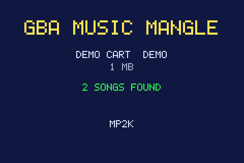
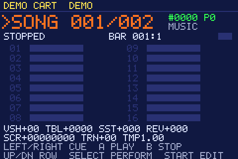
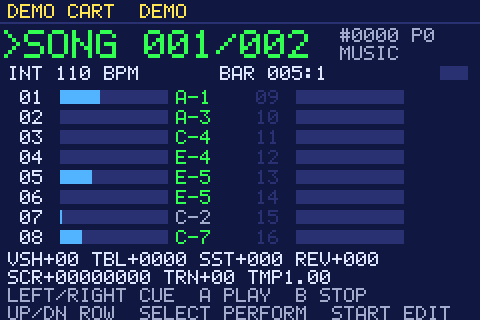
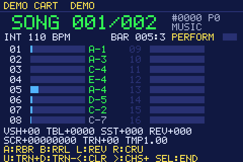
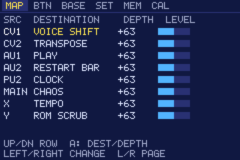
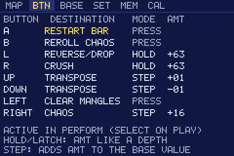
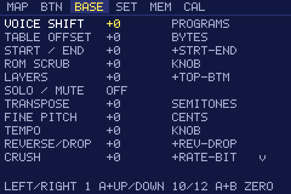
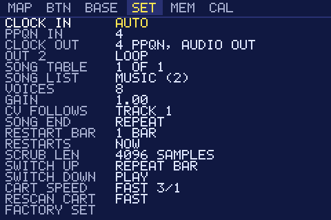
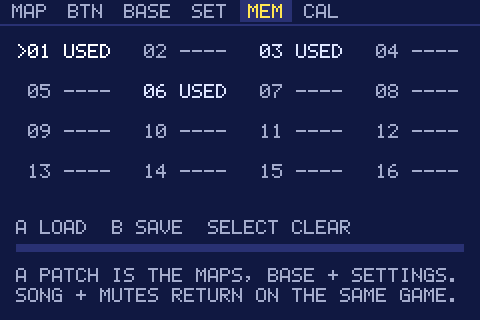
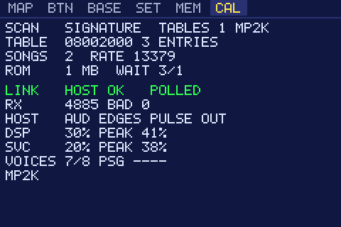

# GBA Music Mangle

A card for the Music Thing Modular **Workshop Computer**. It boots a Game Boy Advance over the link
cable while a game cartridge stays inserted. The GBA finds the game's own music, and plays it so your
modular can drive it: clock it, restart it, loop its bars, strip its tracks back, transpose it, and
mangle its instruments, samples and envelopes, up to per-note CHAOS. It plays five of the GBA's
sound engines: Nintendo's MP2K ("Sappy"), which most GBA games use, and (as previews) Shin'en's
GAX, the Krawall tracker, Factor 5's MusyX and Logik State's GBAModPlay.

Siblings: [89_GBA](https://github.com/uglifruit/89_GBA) (GBA PSG Voice) and
[GBA_FM](https://github.com/uglifruit/GBA_FM) (GBA FM Voice). All three use the same cable and
link.

**Status: beta.** Booting with a cartridge in, the scan and playback have been tried on hardware
(Pokémon Ruby on MP2K, Lady Sia on MusyX, and the universal four-engine build). Everything is
verified on the PC (see "Testing"); GAX and Krawall playback are previews.

## Starting up

1. Connect the GBA's link port to the Workshop: Pulse Out 1 → SC, Pulse Out 2 → SI,
   Pulse In 1 ← SO, and ground. This is the same cable as the sibling cards.
2. Put a game cartridge in the GBA.
3. **Hold START + SELECT while you switch the GBA on.** This tells the GBA to skip the cartridge
   and wait for the Workshop. The Workshop's LEDs show upload progress (about 10 seconds).
4. The GBA scans the cartridge for music, shows how many songs it found, and **cues** the first
   piece of music (sound effects are listed separately; see "Song tables and sound effects").
   Nothing plays until you press **A** (or send a PLAY: Audio In 1, or the switch down).



Use an original or reproduction cartridge. Flash carts usually show their own menu at this point
rather than a game, so they will normally report no music.

### Other engines

Not every game uses Nintendo's engine, and a cart can use more than one. The scan always looks for
MP2K. It looks for **GAX**, **Krawall** and **GBAModPlay** when their names are written in the cart
(GAX's always is; Krawall's is its name or its author's signature in the player's source line;
GBAModPlay's is its credit or its modules' "GBAMOD30" mark), and for **MusyX** (which leaves no
name) when nothing else turns up. A cart that names GAX, Krawall or GBAModPlay skips the
MP2K backup search and MusyX, so its scan is quicker. Each engine's songs are a SONG TABLE of
their own, so a cart with MP2K and GAX shows two; the result screen lists the engines found ("MP2K
+ GAX"), and the PLAY page shows the engine beside the song number. SET > RESCAN CART can be
switched to FULL (LEFT/RIGHT) to look for every engine whatever the cart says.

A Krawall module can hold several songs (games keep jingles and effects that way): each is listed
on its own, and plays until the next one would begin, then loops (or stops, as an effect).

Everything works the same on every engine: cue and PLAY, the clock and clock out, REPEAT BAR, AT
BAR END, transpose, fine pitch, tempo, mutes, layers, solo, voice shift, table offset, sample
start/end, reverse/drop, scrub, crush, reverb and **CHAOS** (on GAX, Krawall, MusyX and GBAModPlay: interval
jumps, hard pans, reverse, random starts, accents and, above half, raw cart data, as a pattern that
repeats each loop). MP2K's own envelopes, note length and LFO have no equivalent on the others: on
the MAP, BTN and BASE pages those destinations are dimmed and marked N/A, and do nothing. On GAX,
Krawall and GBAModPlay, RESTART BAR cuts the sounding notes at the jump, and so does GAX's and
Krawall's RESTART LOOP; MusyX's and GBAModPlay's RESTART LOOP restart the song.

GAX, Krawall, MusyX and GBAModPlay playback are previews: some songs may be incomplete or wrong. The CAL page's
engine row gives each engine's own diagnostics; note it when reporting a song:

| Engine | CAL row | Means |
|---|---|---|
| GAX | `S` songs, `OLD` how many the first, stricter scan would have kept, `FX` effect banks, then the check that turned away the most near-misses (`SHP` shape, `NOT` notes, `INS` instruments, `SMP` samples, `CHN` channels) | Tells a cart with few songs found where the rest went. A GAX 2 cart (2001-02: Tang Tang, Tony Hawk's Pro Skater 3, Bruce Lee ...) shows `V2` and its song count instead. A `U` group at the end (`U` pattern effects, perf-list effects, features: 1 ping-pong, 2 wave modulation) lists what a song asked for that the player skipped; since 2026-11-06 the GAX 2 carts above show none |
| Krawall | `M` modules, `S`/`I` the sample and instrument banks found, unknown effects, error | Two more rows choose its **sample and instrument banks**: Krawall stores them apart from the songs, and the scan takes the largest of each. UP/DOWN picks the row, LEFT/RIGHT steps through the other candidates; the choice is saved with the patch |
| GBAModPlay | `M` modules, `S` the sample bank's instruments, `U` effects skipped, error | Logik State's driver (Super Puzzle Fighter II Turbo; Need for Speed, Driv3r, Medal of Honor: Infiltrator, Lego Bionicle and others use it too). Added 2026-11-06 from a reading of Puzzle Fighter's driver; not heard on hardware yet |
| MusyX | unknown commands, `W` warnings (08: all voices busy, a note took the oldest; 20: a note fell outside its drum kit and played nothing), `R` why notes were turned away (2 no such instrument, 4 bad sample, 8 bad macro or keymap), error | Since 2026-11-06 MusyX plays as the game's own sound driver does (read from the carts): its envelopes, note lengths, Game Boy channel parts and mix |

### "No music found that it can play"

When no engine's songs are found, the scan says what the cart uses instead, and waits for a button:

| Screen shows | Meaning |
|---|---|
| ENGINE: GAX | Shin'en's GAX engine, used by many Western third-party games. The line below gives its version. |
| ENGINE: KRAWALL | The Krawall tracker engine (XM/S3M modules), common in European games. |
| ENGINE: XM x*n* | *n* whole FastTracker 2 modules stored in the cart, with the first one's name. |
| ENGINE: GBAMODPLAY | Logik State's driver. "NO SAMPLE BANK" below it: its modules were found, but not the samples they play. |
| ENGINE UNKNOWN | No known signature: an in-house engine, or one that leaves no text behind. |

A GAX or Krawall name with no songs found adds a red line saying why: "GAX: NO SONGS MATCHED" (with
the check that turned the most away), "GAX 2: NO SONG ENTRIES MATCHED", or what the Krawall search found
("NO SAMPLE BANK", with its counts). XM modules and unnamed engines don't play. If a game you know uses MP2K
reports nothing, try SET > CART SPEED SAFE and SET > RESCAN CART. The CAL page repeats the engine
line. [docs/ENGINES.md](docs/ENGINES.md) has how the engines fit together.

Game Boy and Game Boy Color carts can't be used. They switch the GBA into its Game Boy Color mode
at power-on, so there's nothing for the Workshop to talk to.

## Playing

**Choosing a song only cues it; PLAY plays it.** The big number at the top is the cue: green when
it is what's playing, amber while it waits (with PLAYING and the song that is, beside it). So you
can line up the next song while this one carries on, and bring it in with PLAY.

 

Up / Down moves the cursor through three kinds of row:

| Row | Left / Right | A | B |
|---|---|---|---|
| LIST (top right) | ALL, MUSIC or SFX | | |
| SONG (the big number) | Cue the previous / next song | **Play** the cue (from its start) | **Stop** |
| A track | Jump between the two columns | Mute the track | Solo the track |

| GBA button | Anywhere on the PLAY page |
|---|---|
| L / R | Cue the previous / next song |
| SELECT | **Perform mode** on/off (below) |
| START | Open the editor (MAP, BTN, BASE, SET, MEM, CAL pages; L/R moves between them, START returns) |

The cursor starts on SONG, so A plays straight away. The page also shows the clock, the bar and
beat, all sixteen tracks (activity, current note, mute and solo), and the live value of every
mangle.

### Mangling from the GBA itself

You don't need anything patched to mangle a song:

- **Perform mode** (SELECT on the PLAY page) hands the GBA's buttons over to the **BTN** page's
  mappings. The bottom of the screen shows what each button does. The factory buttons:

  

  | Button | Does |
  |---|---|
  | A | Restart the bar (tap it for a stutter) |
  | B | Reroll the chaos pattern |
  | L / R | Reverse / crush, while held |
  | Up / Down | Transpose up / down a semitone |
  | Left | Clear the mangles (tempo and pitch stay) |
  | Right | More chaos (each press adds some; Left clears it) |

  Each button can **HOLD** a mangle while pressed, **LATCH** it on and off, or **STEP** its base
  value. It can also fire a clock, **PLAY**, **STOP**, a reset, the next song (a cue),
  **RESTART LOOP**, **RESTART BAR**, **REROLL CHAOS** or **CLEAR MANGLES**. A STEP on SONG moves
  the cue by its amount, so a button can browse a long list.
- The **BASE** page sets each mangle's resting value in its own units: voice shift in programs,
  transpose in semitones, layers in tracks stripped, and so on. CV, knobs and buttons all add on
  top. The page scrolls: there are 21 values. LEFT/RIGHT change a value by 1. Hold A and UP/DOWN
  change it in big steps instead of moving the cursor: 12 for TABLE OFFSET (one instrument entry
  in the game's table, so it lands on a neighbouring instrument rather than between two) and for
  TRANSPOSE (an octave), 10 for everything else. A+B puts it back to zero.
- **CLEAR MANGLES** (assign it to a button on the BTN page, or to a CV on MAP) puts every BASE
  value back to zero and switches off every latched button. It leaves tempo, transpose and fine
  pitch alone, because those are where the song sits rather than how it's mangled. It can't move a
  knob or a CV, so anything they're doing carries on.

### Mangling the sound itself

These reach into the engine's own controls, on every voice (samples and Game Boy channels alike):

| Destination | Does |
|---|---|
| ATTACK | Up: notes swell in slowly. Down: snappier. |
| DECAY | Up: notes take longer to fall to their sustain level. Down: shorter. |
| SUSTAIN | Up: held notes stay louder (organ-like). Down: plucky. |
| RELEASE | Up: long tails that ring over each other. Down: notes cut dead. |
| NOTE LENGTH | Up: legato, up to ×4. Down: staccato, down to ¼. |
| REVERB | Adds to the song's own reverb (the engine's echo). Down removes the song's. |
| VIBRATO | Wobbles the pitch of every track. A small amount (4–10) is a normal vibrato. |
| TREMOLO | Wobbles the volume of every track. |
| LFO SPEED | The vibrato and tremolo rate, ×¼ to ×4 around the engine's usual 5 Hz. |

The envelope changes act on notes already sounding, so holding a button (say B on RELEASE, HOLD,
amount 40) stretches the tails of whatever is playing. None of these are in the factory map;
assign them on MAP and BTN.

### Both sides of noon

Every mangle does something in both directions, from a knob either side of noon or a CV either side
of 0 V. These ones have a different effect on each side:

| Destination | Right of noon / positive | Left of noon / negative |
|---|---|---|
| START / END | Start later into each sample | Cut each sample's end off (a chop) |
| LAYERS | Strip tracks from the top | Strip tracks from the bottom |
| SOLO / MUTE | Solo one track, picked by the level | Mute one track, picked by the level |
| REVERSE/DROP | Chance a note plays backwards | Chance a note is dropped (thins it out) |
| CRUSH | Lower sample rate (gritty, aliased) | Fewer bits (noisy, down to one) |
| VIBRATO/TRILL | Smooth pitch wobble | Square wobble: a trill |
| TREMOLO/GATE | Smooth volume wobble | Square wobble: a rhythmic gate |
| CHAOS | A pattern that repeats every loop | Free chaos: new dice every time |

The factory main knob is CHAOS, so left of noon is free chaos and right is the repeating kind.

### Restarting: song, loop, bar

Four actions jump, each one assignable to a button (BTN), a CV or gate (MAP), or both:

| Action | Jumps to |
|---|---|
| PLAY | The start of the cued song. On the song already playing, that's a restart. |
| RESET | The start of the song playing (when nothing is playing, it plays the cue). |
| RESTART LOOP | The song's loop point: most game music is an intro and then a looping body, and this skips the intro. A song that doesn't loop restarts instead. |
| RESTART BAR | The start of the current section. SET > RESTART BAR sets the section: 1 beat, 2 beats, 1 bar, 2 bars or 4 bars. |

**SET > RESTARTS** chooses when they happen: **NOW**, or **AT BAR END**, which holds them until the
next section line so they always land on the grid (the PLAY page shows QUEUED while one waits).
So with AT BAR END, a PLAY of a newly cued song changes songs on the bar line. When nothing is
playing (or an effect is), PLAY happens at once: there is no bar to wait for.
Pushing the switch down counts as a PLAY too. **STOP** stops.

RESTART BAR fed from a clock divider (or tapped on a button) is a **beat-repeat**: the same bar
again and again while the triggers keep coming, and the song carries on when they stop. Notes
already sounding ring on through each jump, and CHAOS rewinds with it, so a repeated bar keeps its
chaos. With an external clock, all three line up with the clock pulse they arrive with.

### CHAOS

**CHAOS** rolls dice on every note. The higher it goes, the more often each thing happens and the
further it goes:

- **Any amount:** notes jump by fifths and octaves, and pan hard left or right.
- **More:** instruments are swapped for random ones from the game's set; samples play backwards
  or start partway in; notes are stretched or chopped.
- **Past halfway:** some notes play raw cart data (the game's code and graphics) as sound.

The dice restart every time the song loops, so chaos is a **pattern that repeats**, not noise: the
same note gets the same treatment each time round. **REROLL CHAOS** deals a new pattern. Try CHAOS on
the main knob or a CV, and REROLL on a button, then reroll until a pattern grabs you. CLEAR MANGLES
stops it, and so does the switch when SET > SWITCH UP is BYPASS.

### Song tables and sound effects

Some cartridges contain more than one set of music. A two-games-in-one cart has one per game. The
scan finds them all, and SET > SONG TABLE switches between them.

Sound effects are songs too. The scan tells them apart **by what they are**, on every engine:

| Kind | What it is | Plays |
|---|---|---|
| SONG | anything that loops | as a song |
| JNGL (jingle) | longer than four bars, and ends | once, as a song |
| SFX | shorter than four bars, and ends (on MP2K also a short loop on an effects player) | once; every PLAY restarts it |

(MP2K games also file their sounds under "music players", and the PLAY page still shows an MP2K
song's player, P0 to P9, but it no longer decides the list: one game put its songs on an effects
player.) The LIST row on the PLAY page (or SET > SONG LIST) shows ALL, MUSIC (songs and jingles) or
SFX. It starts on MUSIC. (Pokémon Ruby has over 400 songs, and the first 250 or so are effects.)
Changing the list stops what's playing and cues its first item. The PLAY page's title says SONG,
JNGL or SFX.

**An effect plays once**, whatever SET > SONG END says, and **every PLAY restarts it at once**,
even with SET > RESTARTS = AT BAR END: it is a one-shot, not a song. That makes the SFX list a drum
machine of the game's sounds:

- **Choose** an effect with L/R, the SONG CV (up to 16 either side), or a button STEPping SONG.
- **Fire** it with PLAY: A on the SONG row, Audio In 1, the switch down, or any gate or button
  mapped to PLAY. Each PLAY starts it again from the top.

## The panel (factory settings; every input can be re-assigned on the MAP page)

| Input | Does |
|---|---|
| Pulse In 2 | **Clock.** Set the PPQN on the SET page (1, 2, 4, 8, 12, 24). With no clock patched, songs play at their own tempo. |
| Audio In 1 | **Play:** start the cued song, in step with the clock (on the song already playing, a restart) |
| Audio In 2 | **Restart bar:** from a clock divider, a beat-repeat |
| CV In 1 | **Voice shift:** every instrument swapped for one further along the game's instrument table |
| CV In 2 | **Transpose,** 1 V/octave, in semitones |
| Main knob | **Chaos:** right of noon a pattern that repeats each loop, left of noon free chaos |
| Knob X | **Tempo** (when not externally clocked), ×0.25 to ×4. Around noon is the song's own tempo. |
| Knob Y | **ROM scrub:** samples are read from elsewhere in the cartridge, a little at first, then a lot. Around noon is off. |
| Switch up | **Repeat bar:** the section playing loops while the switch is up; back to the middle and the song carries on. (SET > SWITCH UP can make it BYPASS, PAUSE or nothing.) |
| Switch down | **Play** the cued song (SET > SWITCH DOWN can make it RESTART, NEXT SONG or nothing) |

The knobs have a wide dead zone at noon, so a knob left roughly in the middle changes nothing.

| Output | Carries |
|---|---|
| CV Out 2 | The followed track's pitch, 1 V/octave (choose the track on the SET page) |
| CV Out 1 | The followed track's gate |
| Audio Out 1 | **Clock out** while a song plays, at SET > CLOCK OUT's PPQN (1, 2, 4, 8, 12 or 24; 4 to start with) |
| Audio Out 2 | A pulse each time the song loops, or (SET > OUT 2 = SONG START) each time a song starts from the top |

The clock out comes from the song's own ticks, so it follows whatever is driving the song: the
external clock (multiplied or divided to the PPQN you choose; 4 PPQN in, 24 out works), or the
internal tempo, TEMPO mangles included. It starts with the song, so the first pulse is the song's
first beat: patch a drum machine to it, and Audio Out 2 on SONG START to the drum machine's reset,
and they stay together through PLAYs and restarts. RESTART BAR and RESTART LOOP jump the song
without disturbing the clock, so a beat-repeat doesn't stutter the drums. While nothing plays, it
is quiet.

Audio comes out of the GBA's own headphone socket.

Other things the MAP page can assign: STOP, reset, next song (a cue), song select by CV (a cue),
layers, start / end, table
offset (reads the instrument table from the wrong place), solo / mute, fine pitch, reverse / drop,
crush, the sound destinations above, RESTART LOOP, REROLL CHAOS, and CLEAR MANGLES (a gate clears
them).

The CAL page shows SVC, the share of each millisecond the modulator and clock take.

The MEM page saves the maps, base values and settings to the Workshop's 16 memory slots: A loads,
B saves, and **SELECT twice clears** the chosen slot. A saved slot also remembers the song table,
list, song and mutes, and restores them when loaded with the same game inserted.

**A saved slot also skips the scan.** Each save remembers which cart it was made on and where that
cart's music is. When you boot with the same cart in (same game and revision), the GBA finds that
slot, loads it, and cues its song in about a second instead of scanning. If several slots were
saved on the cart, the lowest-numbered one is used. Hold **B** while it says CHECKING SAVED SLOTS
to scan instead, and SET > RESCAN CART always scans.

## The pages at a glance

START on the PLAY page opens the editor; L / R move between its pages and START goes back to PLAY.
(The screenshots are of a synthetic test cart, rendered by running the real payload under
emulation: `payload/screenshots.py`.)

 

**MAP** gives each Workshop input (CV 1/2, Audio 1/2, Pulse 2, the three knobs) a destination and a
depth, with its live level. **BTN** does the same for the GBA's eight buttons in perform mode: a
mangle is HELD while pressed, LATCHED, or STEPPED; an action (PLAY, RESTART BAR, REROLL ...) shows
PRESS.

 

**BASE** holds every mangle's resting value, in its own units (it scrolls: there are 21). **SET**
holds the settings: the clock in and out, Audio Out 2, the song table and list, voices, gain, which
track the CV outputs follow, song end, the section length and when restarts happen, the switch,
cart speed, rescan and the factory reset.

 

**MEM** loads and saves the Workshop's 16 patch slots (A load, B save, SELECT twice clears).
**CAL** is the diagnostics: how the scan found the music, the link, the sound load (DSP) and the
service load (SVC), the voices in use, and the playing engine's own report (see "Other engines").

## Building

RP2040 firmware (produces `build/gba_link.uf2`):
```sh
cmake -G Ninja -B build -S .
cmake --build build
```
The GBA payload (regenerates `gba_payload.h`; rebuild the firmware afterwards):
```sh
cd payload && ./build.sh
```
Both use the Pico SDK's toolchain. No devkitPro is needed.

## Testing

```sh
python -I tools/m4a_scan.py yourgame.gba --songs     # what the GBA's scan should find
tools/pcplay/build.sh                                # needs a C compiler; `pip install ziglang` works
python -I tools/pcplay/mktestrom.py test.gba         # a synthetic MP2K cartridge
tools/pcplay/build/pcplay test.gba --songs                  # list songs (--songtable N, --list 0/1/2)
tools/pcplay/build/pcplay test.gba --song 0 --secs 10 --out song.wav
tools/pcplay/build/pcplay test.gba --fuzz 6          # every song, random mangles, bounds-checked
tools/pcplay/build/modtest test.gba                  # the CV / button / base logic
python -I tools/pcplay/mkenginerom.py engines.gba    # a cart with no MP2K, only other engines' signatures
tools/pcplay/build/pcplay engines.gba                # should report GAX KRAWALL XM x2
python -I engines/musyx/tests/make_demo.py msdemo.gba  # a small authored MusyX cart
tools/pcplay/build/pcplay msdemo.gba --song 0 --out musyx.wav
python -I tools/pcplay/mkengines.py eng test.gba     # synthetic GAX, Krawall, and MP2K + GAX carts
tools/pcplay/build/pcplay eng/mixed.gba --songtable 3 --songs   # the GAX table of the mixed cart
tools/pcplay/build/modtest test.gba msdemo.gba eng/gax.gba eng/krawall.gba eng/mixed.gba eng/krawall2.gba eng/gax2.gba
tools/pcplay/build/pcplay yourgame.gba --full --songs          # every engine, as RESCAN FULL
```
`pcplay` renders a song with the payload's own engine, the PSG voices (squares, wave, noise) through
a simple emulation of the Game Boy channels (`--no-psg` leaves them out). Use your own cartridge
dumps.

The briefs and notes: [docs/PLAYER_SPEC.md](docs/PLAYER_SPEC.md) (the player's interface and
rules).

## Licence

MIT, see [LICENSE](LICENSE), except the Krawall player: `engines/krawall/krawall.c` and
`engines/krawall/kr_tables.c`/`.h` are ported from Sebastian Kienzl's Krawall
([github.com/sebknzl/krawall](https://github.com/sebknzl/krawall)) and stay under the GNU Lesser General
Public License 2.1, see [engines/krawall/COPYING.LGPL](engines/krawall/COPYING.LGPL). The firmware and
payload may be shared freely; whoever hands on a built UF2 must also offer the source of those files
(this repository does), so anyone can rebuild it with their own changes.
