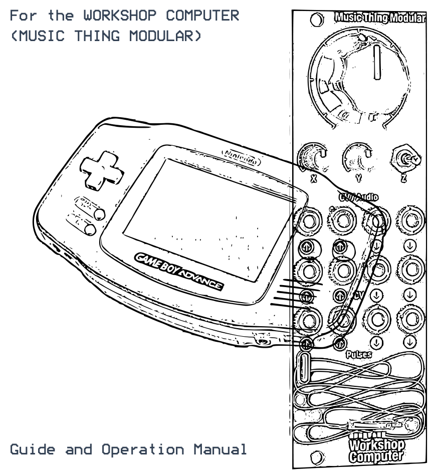
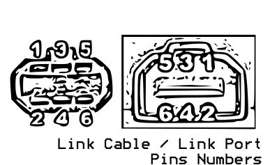

# GBA Music Mangle

A program card for the Music Thing Modular **Workshop Computer** that plays the music **inside a
Game Boy Advance cartridge**, under the control of your modular. Leave a game in the GBA, and the
Workshop loads its own software over the link cable. The GBA finds the game's music and plays it with
the game's own instruments, while your rack clocks it, restarts it, loops its bars, strips its tracks
back, transposes it and mangles it, up to per-note CHAOS.

Most GBA games use Nintendo's own sound engine, and it plays those. It also plays (as previews) games
using Shin'en's GAX, the Krawall tracker, Factor 5's MusyX and Logik State's GBAModPlay.

It is the sibling of **[GBA PSG Voice](https://github.com/uglifruit/89_GBA)** and **[GBA FM
Voice](https://github.com/uglifruit/GBA_FM)**: the same cable and the same loader.

**[Further information](docs/MORE.md)** · **[Program Card Firmware](UF2/gba_link.uf2)**

> **Beta.** Tested on hardware with Pokémon Ruby, Lady Sia and others; testing still under way.

---

## What you need

- **A Game Boy Advance or GBA SP.** The GBA SP has no headphone socket, so it needs Nintendo's SP
  headphone adapter. (The Analogue Pocket can't be used: it can't be made to wait for the link with
  a cartridge inserted.)
- **A GBA game cartridge**: an original or a reproduction. (Flash carts show their own menu instead
  of a game, so they find no music. Game Boy and Game Boy Color carts can't be used.)
- **A link cable** wired to the Workshop's pulse jacks (see [below](#the-cable)): the same cable as
  the sibling cards.
- **The firmware**, [`UF2/gba_link.uf2`](UF2/gba_link.uf2), flashed to the Workshop Computer.

## Getting started

1. Connect the GBA to the Workshop with the link cable, and put a game in the GBA.
2. Switch on the **Workshop Computer** first.
3. **Hold START + SELECT** while you switch the **GBA** on. This makes the GBA skip the game and wait
   for the Workshop. The Workshop's LEDs light in sequence as the software loads (about 25 seconds).
4. The GBA searches the cartridge for music and shows how many songs it found.

   

5. The PLAY page appears with the first song **cued**. Press **A** to play it.

Sound comes from the **GBA's headphone socket**. It is quiet by Eurorack standards, so plug it into a
mixer or another input with gain.

**"No music found that it can play"?** The game uses a sound engine this card doesn't know; the
screen names it if it can. If you know the game uses Nintendo's engine, try SET > CART SPEED SAFE,
then SET > RESCAN CART.

## The cable

| Pin | Signal | Connect to |
|-----|--------|------------|
| 1 | VDD | nothing |
| 2 | SO | **Pulse In 1** |
| 3 | SI | **Pulse Out 2**, through a **1 kΩ resistor** |
| 4 | SD | nothing |
| 5 | SC | **Pulse Out 1**, through a **1 kΩ resistor** |
| 6 | GND | ground |

- **Don't leave out the resistors.** The pulse outputs swing to about 6 V and the GBA runs at 3.3 V.
- **Use a Game Boy Color link cable** if you can. They have all six wires; many third-party GBA
  cables don't.

## Connections

| Inputs | Default job |
|---|---|
| **Pulse In 2** | **Clock** (set its PPQN on the SET page). Unpatched, songs play at their own tempo. |
| **Audio In 1** | **Play** the cued song |
| **Audio In 2** | **Restart bar**: from a clock divider, a beat-repeat |
| **CV In 1** | **Voice shift**: every instrument swapped for another from the game |
| **CV In 2** | **Transpose**, 1V/oct |
| **Main knob** | **Chaos**: right of noon a pattern that repeats each loop, left of noon free chaos |
| **X knob** | **Tempo**, ×¼ to ×4 |
| **Y knob** | **ROM scrub**: samples read from the wrong part of the cartridge |
| **Z switch** | up = **repeat** the bar playing, down = **play** the cued song |
| **Pulse In 1** | GBA SO (link cable) |

| Outputs | Job |
|---|---|
| **CV Out 1** | Gate of the followed track (choose the track on SET) |
| **CV Out 2** | Pitch of the followed track, 1V/oct |
| **Audio Out 1** | **Clock out** while a song plays (4 PPQN to start with) |
| **Audio Out 2** | A pulse each time the song loops (or each time a song starts) |
| **Pulse Out 1** | GBA SC (link cable) |
| **Pulse Out 2** | GBA SI (link cable) |

The knobs are centred: **noon leaves the song as it is**. Every input can be reassigned on the GBA's
**MAP** page.

The clock out follows whatever drives the song (your clock, or the internal tempo) and starts with
the song. Patch a drum machine to Audio Out 1, and Audio Out 2 set to SONG START to its reset, and
the two stay together through every PLAY and restart.

---

## Playing

 

**Choosing a song only cues it; PLAY plays it.** The big number is the cue: amber while it waits,
green once it plays. So you can line up the next song while this one carries on.

| On the PLAY page | |
|---|---|
| **L / R** | Cue the previous / next song |
| **A** (on the song number) | **Play** the cued song from its start |
| **B** (on the song number) | **Stop** |
| **Up / Down** | Move between the list, the song and the tracks |
| **A / B** (on a track) | Mute / solo it |
| **Left / Right** (on the list) | Show ALL, MUSIC or SFX |
| **SELECT** | **Perform mode** on / off |
| **START** | The settings pages (L / R move between them, START comes back) |

The page shows the tempo, the bar and beat, every track's activity and note, and the live value of
each mangle.

### Songs, jingles and sound effects

The game's sounds are sorted for you: **MUSIC** (songs, which loop, and jingles, which play once) and
**SFX** (short effects). The list starts on MUSIC. An effect plays once, and **every PLAY restarts it
at once**, so the SFX list works as a drum machine of the game's sounds: choose one with L/R, fire it
with PLAY from a gate on Audio In 1.

## Perform mode

**SELECT** on the PLAY page hands the GBA's buttons over to mangling. The bottom of the screen shows
what each one does:

| Button | Does |
|---|---|
| **A** | Restart the bar (tap it for a stutter) |
| **B** | A new chaos pattern |
| **L / R** | Reverse / crush, while held |
| **Up / Down** | Transpose up / down a semitone |
| **Left** | Clear the mangles (tempo and pitch stay) |
| **Right** | More chaos |

Change what they do on the **BTN** page.

## The mangles

Every input, knob and button can drive any of these (MAP and BTN pages), and the **BASE** page sets
where each one rests. Most do something either side of noon:

| Mangle | Right of noon | Left of noon |
|---|---|---|
| **Voice shift** | Every instrument swapped for one further along the game's set | ...further back |
| **Table offset** | The game's instrument table read from the wrong place | |
| **Start / End** | Each sample starts later | Each sample's end is chopped |
| **Layers** | Tracks stripped from the top | ...from the bottom |
| **Solo / Mute** | One track soloed | One track muted |
| **Reverse / Drop** | Notes play backwards, by chance | Notes are dropped, by chance |
| **Crush** | Lower sample rate | Fewer bits |
| **ROM scrub** | Samples read from elsewhere in the cartridge | |
| **Transpose**, **Fine pitch**, **Tempo** | Up | Down |
| **Chaos** | Dice on every note, repeating each loop | Free chaos, never repeating |

On games using Nintendo's engine there are also **Attack, Decay, Sustain, Release, Note length,
Reverb, Vibrato, Tremolo and LFO speed**, acting on the game's own envelopes and effects. (The other
engines show these as N/A.)

**CHAOS** rolls dice on every note. A little makes notes jump by fifths and octaves and pan hard;
more swaps instruments, reverses samples and stretches notes; past halfway, some notes play the
cartridge's raw data as sound. The dice restart each time the song loops, so chaos is a **pattern
that repeats**. **REROLL** deals a new one.

**CLEAR MANGLES** puts everything back to clean, except tempo and pitch.

## Restarting and looping

| Action | Jumps to |
|---|---|
| **PLAY** | The start of the cued song |
| **RESET** | The start of the song playing |
| **RESTART LOOP** | The song's loop point (past the intro) |
| **RESTART BAR** | The start of the current bar (or 1 beat to 4 bars: SET > RESTART BAR) |

With **SET > RESTARTS = AT BAR END**, they wait for the next bar line, so they always land on the
grid. RESTART BAR from a clock divider is a **beat-repeat**: the same bar again and again while the
triggers keep coming. The **Z switch up** repeats the bar playing until you let it go.

## The settings pages

**START** on the PLAY page opens them; **L / R** move between them; **START** goes back.

 

**MAP**: what each Workshop input does, and how much. **BTN**: what each GBA button does in perform
mode, and whether it holds, latches or steps.

 

**BASE**: where each mangle rests (LEFT/RIGHT change it; A+UP/DOWN in big steps; A+B back to zero).
**SET**: the clock in and out, the song list, voices, volume, the track the CV outputs follow, what
the switch does, and the cart rescan.

 

**MEM**: the Workshop's 16 memory slots. **A** loads, **B** saves, **SELECT twice** clears. A slot
remembers your maps, settings, the song and the mutes. Saved with a game in, it also lets that game
start in about a second next time, without the search (hold **B** while it says CHECKING SAVED SLOTS
to search anyway). **CAL**: what the search found and how the link is doing, useful when reporting
a problem.

---

## More

- **[Further information](docs/MORE.md)**: the other sound engines and what the CAL page's codes
  mean, building from source, and the test tools.

By **Andy Jenkinson** (YT/IG @uglifruity), 2026. Built on Chris Johnson's ComputerCard library for
Tom Whitwell's Music Thing Modular Workshop Computer. MIT licensed, except the Krawall player, which
is LGPL-2.1 (see [Further information](docs/MORE.md#licence)).
